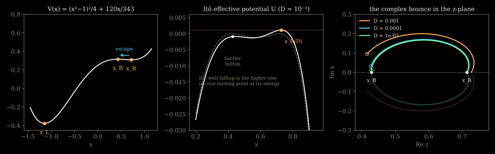
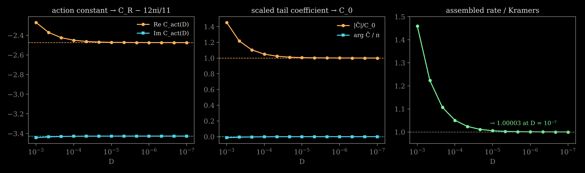

The cubic and the sine-Gordon potentials share an accident: the curvature of the well equals the curvature of the barrier. The tilted quartic breaks it, and what it exposes is the one ingredient the equal-curvature calculations could not see. This page carries the calculation from the potential to Kramers' rate with every constant explicit; it is the content of a paper in preparation with Steve Fitzgerald and Alan McKane, and every number below has been checked independently of the paper with [the script at the bottom](/assets/research/quartic_check.py).

## 1. The potential and the target

$$
V(x) = \tfrac14(x^2 - 1)^2 + \epsilon x, \qquad \epsilon = \frac{120}{343}, \qquad V'(x) = x^3 - x + \epsilon = \Big(x + \tfrac87\Big)\Big(x - \tfrac37\Big)\Big(x - \tfrac57\Big).
$$

The tilt is chosen so that everything is rational: the deep well at $x_L = -8/7$, the barrier at $x_B = 3/7$, the metastable well at $x_R = 5/7$. Escape is from $x_R$ over $x_B$. The three numbers that matter are

$$
\kappa_R = V''(x_R) = \frac{26}{49}, \qquad \kappa_B = |V''(x_B)| = \frac{22}{49}, \qquad \Delta V_R = V(x_B) - V(x_R) = \frac{16}{2401},
$$

and the rate the path integral has to reproduce is Kramers',

$$
k_{R\to L} \sim \frac{\sqrt{\kappa_R\kappa_B}}{2\pi}\,e^{-\Delta V_R/D} = \frac{\sqrt{572}}{98\pi}\,e^{-16/2401D} .
$$

The exact mean first-passage time from $x_R$ to $x_L$ confirms this is the right target: $(1/T)e^{\Delta V_R/D}$ divided by the Kramers prefactor is $0.844$, $0.890$, $0.950$ at $D = 4, 2, 1 \times 10^{-3}$, approaching $1$ linearly in $D$.

## 2. Effective potential, hilltop, turning points

With $f = V'$ the Itô action is $\mathcal A = \frac{V(z_f) - V(z_i)}{2D} + \frac{1}{4D}\int dt\,[\dot z^2 - U(z)]$ with

$$
U(z) = -f(z)^2 + 2D f'(z) = -(z^3 - z + \epsilon)^2 + 2D(3z^2 - 1),
$$

equation of motion $\ddot z = -\tfrac12 U'(z)$ and first integral $\dot z^2 + U(z) = E$. The hilltop of $U$ near the metastable well, $a_R(D)$, solves $f(a)f'(a) = 6Da$:

$$
a_R(D) = \frac57 + \frac{5145}{338}\,D + O(D^2),
$$

(the coefficient is $6x_R/\kappa_R^2$; numerically $a_R(10^{-5}) = 0.7144377$ against $0.7144379$ from the expansion). The bounce lives at the hilltop energy $E_R = U(a_R)$, where $a_R$ is a double root of $U(a_R) - U(z)$, so

$$
U(a_R) - U(z) = (a_R - z)^2\,Q_R(z), \qquad Q_R(z) = z^4 + 2a_Rz^3 + (3a_R^2 - 2)z^2 + (4a_R^3 - 4a_R + 2\epsilon)z + 5a_R^4 - 6a_R^2 + 4\epsilon a_R + 1 - 6D .
$$

At $D = 0$, $Q_R = (z + \tfrac87)^2(z - \tfrac37)^2$. For small $D$ the double root at the barrier splits into a conjugate pair,

$$
\rho_{B,\pm} = \frac37 \pm i\,\frac{14\sqrt6}{11}\sqrt D + O(D),
$$

which follows from $U(a_R) - U(x_B + x) = \kappa_B^2x^2 + \tfrac{96}{49}D + \dots$, the $96/49 = 2(\kappa_R + \kappa_B)$ being the height difference between the two tilted hilltops. As in the cubic, the well hilltop is the higher one, so there is no real turning point at its energy and the bounce from the well is necessarily complex. (A real bounce from the *barrier* hilltop exists, and a kink pair to the left well; neither contributes to escape from $x_R$, and they are not needed below.)

## 3. The exact complex bounce is a Weierstrass function

The first-order equation $\dot z^2 = (a_R - z)^2Q_R(z)$ has the double root sitting at the endpoint of the trajectory, which is what makes the bounce take infinite time. Remove it with the Sundman transformation

$$
\frac{du}{dt} = a_R - z, \qquad\text{so that}\qquad \Big(\frac{dz}{du}\Big)^2 = Q_R(z).
$$

A quartic with a known root reduces to Weierstrass form by the classical substitution. With $\xi = z - \rho$, $q_j = Q_R^{(j)}(\rho)$ and $Q_R$ monic, $Q_R(\rho + \xi) = q_1\xi + \tfrac{q_2}{2}\xi^2 + \tfrac{q_3}{6}\xi^3 + \xi^4$; then $\xi = 1/y$, $W = \tfrac{q_1}{4}y + \tfrac{q_2}{24}$ gives $W'^2 = 4W^3 - g_2W - g_3$ with

$$
g_2 = \frac{q_2^2}{48} - \frac{q_1q_3}{24}, \qquad g_3 = -\frac{q_2^3}{1728} + \frac{q_1q_2q_3}{576} - \frac{q_1^2}{16}.
$$

Placing the turning point at the pole of $\wp$,

$$
\boxed{\;z(u) = \rho_{B,+} + \frac{Q_R'(\rho_{B,+})}{4\big[\wp(u; g_2, g_3) - Q_R''(\rho_{B,+})/24\big]}\;}
$$

with $z(0) = \rho$, $z_u(0) = 0$, and $z = a_R$ at $u = \pm\alpha$ where $\wp(\alpha) = Q_R''(\rho)/24 + Q_R'(\rho)/4(a_R - \rho)$. Physical time is the Abelian integral of the third kind $t(u) = \int_0^u dv/(a_R - z(v))$, which the standard identity turns into

$$
t(u) = \frac{1}{a_R - \rho}\left[u + \frac{\wp(\alpha) - Q_R''(\rho)/24}{\wp'(\alpha)}\Big\{\log\Big(-\frac{\sigma(u-\alpha)}{\sigma(u+\alpha)}\Big) + 2u\,\zeta(\alpha)\Big\}\right],
$$

with $t \to \pm\infty$ as $u \to \pm\alpha$ and $t(u) = -\Omega_R^{-1}\log(\alpha - u) + O(1)$ near the end, where

$$
\Omega_R(D) = \sqrt{Q_R(a_R)} = \sqrt{-\tfrac12U''(a_R)} \;\to\; \kappa_R
$$

is the rate at which the bounce settles back onto the hilltop. The cubic's $\tanh$ and the sine-Gordon $\arctan$ are this formula in the degenerate case where two roots of $Q$ coincide and $\wp$ collapses to $1/\sinh^2$. In the $z$-plane (right panel of the figure) the bounce is a bounded arc from $\rho_{B,+}$ to $a_R$, returning along the other sheet of $y^2 = U(a_R) - U(z)$; as $D \to 0$ it tends to a fixed arc, as the cubic's does and the sine-Gordon's does not. The closed form satisfies $(dz/du)^2 = Q_R(z)$ to the accuracy of the Weierstrass ODE integration, and the real-time trajectory integrated directly from the turning point lands on $a_R$ to twelve digits.

## 4. The action: elliptic in closed form, elementary in the limit

For the homoclinic path the boundary term vanishes and, relative to sitting at $a_R$,

$$
\Delta\mathcal S = 4I_+(D), \qquad I_+(D) = \int_{\rho_{B,+}}^{a_R}\sqrt{U(a_R) - U(z)}\,dz = \int_0^\alpha (a_R - z(u))\,Q_R(z(u))\,du,
$$

so that the weight of the saddle is $e^{-\mathcal B}$ with $\mathcal B_{R,+} = I_+/D$. In the $u$ variable the integrand is a quintic in $1/(\wp(u) - h)$, $h = q_2/24$, and $\int_0^u dv/(\wp(v) - h)^n$ are $h$-derivatives of the same third-kind integral as $t(u)$, so $I_+$ is a finite combination of $\sigma$, $\zeta$ and $\wp$ at $\alpha$: closed, but not illuminating. The weak-noise form is what matters, and it comes from matched asymptotics.

*Outer region*, $x_B < z < x_R$ away from the barrier: $U(a_R) = 2D\kappa_R + O(D^2)$, so

$$
\sqrt{U(a_R) - U(z)} = -V'(z) + D\,\frac{\kappa_R - f'(z)}{-f(z)} + O(D^2) = -V'(z) + D\,\frac{3(x_R + z)}{(z - x_L)(z - x_B)} + O(D^2),
$$

using $f'(x_R) - f'(z) = 3(x_R - z)(x_R + z)$, and by partial fractions

$$
\frac{3(x_R + z)}{(z - x_L)(z - x_B)} = \frac{24}{11}\,\frac{1}{z - x_B} + \frac{9}{11}\,\frac{1}{z - x_L}.
$$

*Inner region* near the barrier, $z = x_B + x$: $U(a_R) - U = \kappa_B^2(x^2 + \lambda^2)$ with $\lambda = \tfrac{14\sqrt6}{11}\sqrt D$, and $\int_{i\lambda}^X\kappa_B\sqrt{x^2 + \lambda^2}\,dx$ expanded for large $X$ differs from the outer form $\int(\kappa_Bx + \kappa_B\lambda^2/2x)$ by the constant $\tfrac{\kappa_B\lambda^2}{2}\big[\tfrac12 + \log\tfrac2\lambda - \tfrac{i\pi}{2}\big]$, where $\kappa_B\lambda^2/2 = \tfrac{24}{11}D$ exactly. Matching, with $\int_{x_B}^{x_R}(-V')\,dz = \Delta V_R$:

$$
I_+(D) = \Delta V_R + D\left[\frac{24}{11}\Big\{\log\frac{22}{49\sqrt{6D}} + \frac12 - \frac{i\pi}{2}\Big\} + \frac{9}{11}\log\frac{13}{11}\right] + o(D),
$$

$$
\boxed{\;\mathcal B_{R,\pm}(D) = \frac{\Delta V_R}{D} - \frac{12}{11}\log D + C_R \mp \frac{12\pi i}{11} + o(1), \qquad C_R = \frac{24}{11}\Big[\log\frac{22}{49\sqrt6} + \frac12\Big] + \frac{9}{11}\log\frac{13}{11} = -2.474208649\ldots\;}
$$

The $\log D$ coefficient is $\kappa_R/\kappa_B + 1 = 24/11$ halved; the phase $12\pi/11$ is $p\pi$ with $p = (\kappa_R + \kappa_B)/2\kappa_B$, and it is the quartic's version of the cubic's $\pm i\pi$. Numerically, $C_{\rm act}(D) \equiv (I_+ - \Delta V_R)/D + \tfrac{12}{11}\log D$ computed by contour quadrature is $-2.269 - 3.444i$ at $D = 10^{-3}$ and $-2.47418 - 3.42719i$ at $D = 10^{-7}$, against $C_R - 12\pi i/11 = -2.47421 - 3.42719i$.

## 5. The tail and the determinant

The bounce approaches the hilltop as $a_R - z(t) \sim \mathcal C_+(D)\,e^{-\Omega_R t}$, with the complex tail coefficient given exactly by

$$
\log\mathcal C_+ = \log(a_R - \rho_{B,+}) + \int_{\rho_{B,+}}^{a_R}\frac{dz}{a_R - z}\left[\frac{\Omega_R}{\sqrt{Q_R(z)}} - 1\right].
$$

(Integrating the real-time trajectory directly and reading off $(a_R - z)e^{\Omega_Rt}$ at $t = 50$ gives $-2.59131 - 8.66904i$ at $D = 10^{-4}$; the integral gives $-2.59108 - 8.66838i$.) The fluctuation operator $\mathcal M_+ = -d^2/dt^2 - \tfrac12U''(z_{\rm cl})$ has the exact zero mode $\dot z_{\rm cl}$, with analytically continued norm $N_+ = \int\dot z^2\,dt = 2I_+$. The McKane–Tarlie master formula used on the [sine-Gordon page](/research/bounces/sine-gordon/) needs only the asymptotic amplitudes of the zero mode, $\alpha_\pm = \pm\Omega_R\mathcal C_+$ by evenness, and gives the exact infinite-line result

$$
\boxed{\;\frac{\det{}'\mathcal M_+}{\det\mathcal M_0} = -\frac{I_+(D)}{\Omega_R^3\,\mathcal C_+^2}\;}
$$

with $\mathcal M_0 = -d^2/dt^2 + \Omega_R^2$. The weak-noise form of $\mathcal C_+$ is best read off the instanton–anti-instanton picture of §7: the well-side tail of the bounce is the well-side tail of a single kink, $A_R\,e^{-\kappa_R(t - \tau_*/2)}$, displaced by half the complex separation $\tau_*$, so $\mathcal C_+ = A_R\,e^{\kappa_R\tau_*/2}$ and, with $e^{-\kappa_B\tau_*} = -pD/g$,

$$
\mathcal C_+(D) = \mathcal C_0\,D^{-13/22}e^{-13\pi i/22}\,[1 + o(1)], \qquad \mathcal C_0 = \frac27\Big(\frac{22}{49\sqrt6}\Big)^{13/11}\Big(\frac{11}{13}\Big)^{2/11} = 0.0373180851\ldots,
$$

the exponent $13/22$ being $\kappa_R/2\kappa_B$. The scaled quantity $D^{13/22}e^{13\pi i/22}\mathcal C_+$ is $1.049\,\mathcal C_0$ at $D = 10^{-4}$ and $1.00004\,\mathcal C_0$ at $D = 10^{-7}$, with phase tending to zero. Hence

$$
\frac{\det{}'\mathcal M_+}{\det\mathcal M_0} = -K_{\det}\,D^{13/11}e^{13\pi i/11}\,[1 + o(1)], \qquad K_{\det} = \frac{\Delta V_R}{\kappa_R^3\,\mathcal C_0^2} = 32.0300\ldots
$$

The determinant is negative at $D = 0$ (the real bounce has one unstable mode) and is followed continuously into the complex plane: its argument is $\pi + 13\pi/11 = 24\pi/11$, so $(\det{}'\mathcal M_+/\det\mathcal M_0)^{-1/2}$ carries the phase $e^{-12\pi i/11}$, exactly cancelling the phase of $e^{-\mathcal B_{R,+}}$. The rate is real.

## 6. The hard prefactor

Collecting the exact-saddle pieces, with the translation collective coordinate $J_{\rm tr} = \sqrt{N_+/4\pi D} \to \sqrt{\Delta V_R/2\pi D}$,

$$
K_{\rm hard} \equiv e^{-\mathcal B_{R,+} + \Delta V_R/D}\,J_{\rm tr}\,\Big(\frac{\det{}'\mathcal M_+}{\det\mathcal M_0}\Big)^{-1/2} .
$$

The powers of $D$ cancel, $D^{12/11}\cdot D^{-1/2}\cdot D^{-13/22} = D^0$, the phases cancel, and

$$
K_{\rm hard} = \frac{e^{-C_R}\,\kappa_R^{3/2}\,\mathcal C_0}{\sqrt{2\pi}} = \frac{2\sqrt{78}}{49\sqrt\pi}\,e^{-12/11} = 0.0683173\ldots
$$

The second equality is not obvious from the constants as written; it is the identity (iii) of §7, and it is what connects the exact saddle to the kink picture. Kramers' prefactor is $\sqrt{572}/98\pi = 0.0776823$, so $K_{\rm hard}$ is $0.879$ of the answer, and the remaining factor has to come from the quasi-zero mode.

## 7. The instanton–anti-instanton family and three identities

The elementary kink $q(s)$ from the barrier to the well solves $q' = -V'(q)$ and, with $q(0) = m = 4/7$ (the midpoint), is given implicitly by the partial fractions of $1/V'$:

$$
s = \frac{1}{\kappa_B}\log\frac{q - x_B}{m - x_B} - \frac{1}{\kappa_R}\log\frac{x_R - q}{x_R - m} - \frac{49}{143}\log\frac{q - x_L}{m - x_L},
$$

where $1/\kappa_B$, $1/\kappa_R$ and $-49/143$ are the residues of $1/[(z - x_L)(z - x_B)(x_R - z)]$ at $x_B$, $x_R$, $x_L$. Its two tails are

$$
q - x_B \sim A_B\,e^{\kappa_Bs}\ (s \to -\infty), \quad x_R - q \sim A_R\,e^{-\kappa_Rs}\ (s \to +\infty), \qquad A_B = \tfrac17\,2^{11/13}\big(\tfrac{11}{12}\big)^{2/13}, \quad A_R = \tfrac17\,2^{13/11}\big(\tfrac{13}{12}\big)^{-2/11},
$$

read off by sending $q$ to each end of the implicit formula. A pair at separation $\tau$ is $z_\tau(t) = q(-t - \tau/2) + q(t - \tau/2) - x_B$, and inserting it into the action for large $\tau$ gives

$$
\mathcal B_{\rm cl}(\tau) = \frac{\Delta V_R}{D} + c_0 - \frac{g}{D}e^{-\kappa_B\tau} + p\,\kappa_B\tau + o(1),
$$

with three constants, each elementary:

- $g = \kappa_BA_B^2$: the attraction from the overlap of the two barrier-side tails, $\Delta\mathcal S = -4\kappa_BA_B^2e^{-\kappa_B\tau}$, divided by $4D$.
- $p = \dfrac{\kappa_R + \kappa_B}{2\kappa_B} = \dfrac{12}{11}$: the Itô term $-\tfrac12\int V''\,dt$ charges $-\kappa_R/2$ per unit time in the well and $+\kappa_B/2$ on the barrier, so lengthening the plateau by $d\tau$ costs $\tfrac12(\kappa_R + \kappa_B)\,d\tau$.
- $c_0 = \log\dfrac{\kappa_RA_R}{\kappa_BA_B} = 0.398552\ldots$: the Itô term over the two cores. This follows from $\int f'(q)\,ds = -[\log\dot q]$ along a kink, so that the regularised core integral is the log of the ratio of the tail velocities, $\kappa_RA_R$ against $\kappa_BA_B$.

The classical critical point is $e^{-\kappa_B\tau_*} = -pD/g$, i.e. $\tau_* = \kappa_B^{-1}\log(g/pD) - i\pi/\kappa_B$, complex exactly as in the cubic. Evaluating $\mathcal B_{\rm cl}(\tau_*)$ and the tail of $z_{\tau_*}$ must reproduce the exact saddle, and it does, to ten digits:

$$
\text{(i)}\ \ \mathcal C_0 = A_R\Big(\frac gp\Big)^{13/22}, \qquad
\text{(ii)}\ \ C_R = c_0 + p\Big(1 + \log\frac gp\Big), \qquad
\text{(iii)}\ \ e^{-C_R}\kappa_R\,\mathcal C_0 = \sqrt{\kappa_Bp}\;e^{-p}.
$$

The third is a consequence of the first two together with $c_0 = \log(\kappa_RA_R/\kappa_BA_B)$ and $g = \kappa_BA_B^2$: the amplitudes $A_R$, $A_B$ drop out entirely. Through (iii), §6 becomes

$$
K_{\rm hard} = \frac{\sqrt{\kappa_R\kappa_B}}{2\pi}\,\sqrt{2\pi p}\;e^{-p},
$$

which is Kramers' prefactor times the Gaussian-about-$\tau_*$ value of the quasi-zero-mode integral in the classical potential. What remains is to replace that Gaussian by the exact thimble integral, and here the quartic parts company with the cubic.

## 8. The thimble integral with a flat measure comes out 5% short

In the centred coordinate $w = \kappa_B(\tau - \tau_*)$ the classical potential is $\Delta\mathcal B_{\rm cl}(w) = p\,(e^{-w} + w - 1)$, with a regulator $\nu$ rotating $e^{-\kappa_B\tau}$ as on the [error factor page](/thimble/); the critical points are $\tau_\sigma = \kappa_B^{-1}[\log(g/pD) + (2\sigma - 1)i\pi - i\nu]$, the thimbles are the horizontal lines $\mathbb R + \tfrac{i}{\kappa_B}[(2\sigma - 1)\pi - \nu]$, and the intersection numbers select exactly one of them. On it, with $\xi = pe^{-w}$,

$$
\frac{1}{\kappa_B}\int_{\mathbb R}e^{-p(e^{-w} + w - 1)}\,dw = \frac{e^p\,p^{-p}\,\Gamma(p)}{\kappa_B}, \qquad \text{Gaussian:}\ \frac{1}{\kappa_B}\sqrt{\frac{2\pi}{p}}, \qquad \frac{\text{exact}}{\text{Gaussian}} = \frac{e^p\,\Gamma(p)}{\sqrt{2\pi}\,p^{\,p - 1/2}} = 1.077447\ldots
$$

Multiplying $K_{\rm hard}$ by this gives $K/K_{\rm Kramers} = \Gamma(p)\,p^{1-p} = 0.947555$: the direct extension of the cubic prescription is $5.24\%$ below Kramers. Every local quantity at the saddle is correct, so the deficit is global: something along the valley, not at the critical point.

## 9. The missing piece: the one-loop measure is transported along the valley

Write the fluctuation expansion about the family as $z = z_{\tau}(t) + \eta_\perp$, with $\eta_\perp$ orthogonal to translation and to the valley direction. The reduced measure on the valley is $d\tau\,J(\tau)\,[\det_\perp\mathcal M_{\perp,\tau}]^{-1/2}$. The Jacobian $J$ is constant to leading order, because the kinks' overlap is exponentially small. The transverse determinant is not. On a stretch of length $L$ where the path sits at a stationary point of $U$ with $-\tfrac12U'' = \kappa^2$, the operator is $-d^2/dt^2 + \kappa^2$ and its Gel'fand–Yaglom determinant grows as $e^{\kappa L}/2\kappa$. Lengthening the barrier plateau by $d\tau$ replaces well-vacuum (rate $\kappa_R$) by barrier-vacuum (rate $\kappa_B$), so

$$
d\log\det_\perp\mathcal M_\tau = (\kappa_B - \kappa_R)\,d\tau, \qquad F(\tau) \equiv \frac{J(\tau)}{J(\tau_*)}\Big[\frac{\det_\perp\mathcal M_{\perp,\tau}}{\det_\perp\mathcal M_{\perp,\tau_*}}\Big]^{-1/2} = \exp\Big[\frac{\kappa_R - \kappa_B}{2}(\tau - \tau_*)\Big][1 + o(1)].
$$

$F$ is not a new collective coordinate and not an extra determinant; it is the variation along the valley of the Gaussian volume that was already in the path integral, normalised to $1$ at the saddle. The transverse Gaussians are fatter on the barrier because the barrier is softer. The correct reduced integrand is $F(\tau)\,e^{-\mathcal B_{\rm cl}(\tau)}$, which is $e^{-\mathcal B_{\rm eff}}$ with

$$
\mathcal B_{\rm eff}(\tau) = \mathcal B_{\rm cl}(\tau) - \log F(\tau) = \text{const} - \frac gD e^{-\kappa_B\tau} + \Big[\frac{\kappa_R + \kappa_B}{2} - \frac{\kappa_R - \kappa_B}{2}\Big]\tau = \text{const} - \frac gD e^{-\kappa_B\tau} + \kappa_B\,\tau .
$$

The linear coefficient is now exactly $\kappa_B$, the decay rate of the interaction. For the quartic that is $12/11 \to 1$, i.e. $F(w) = e^{w/11}$. In the centred variable $\Delta\mathcal B_{\rm eff} = pe^{-w} + w - p$, with its minimum shifted to $w = \log p$, and on the thimble

$$
\frac{1}{\kappa_B}\int e^{-(pe^{-w} + w - p)}\,dw = \frac{e^p}{p\,\kappa_B} = \frac{e^p}{\kappa_B}\,\Gamma(1)\cdot\frac1p, \qquad \frac{\text{exact}}{\text{Gaussian}} = \frac{e^p}{\sqrt{2\pi p}} .
$$

Then

$$
K = K_{\rm hard}\cdot\frac{e^p}{\sqrt{2\pi p}} = \frac{\sqrt{\kappa_R\kappa_B}}{2\pi}\,\sqrt{2\pi p}\,e^{-p}\cdot\frac{e^p}{\sqrt{2\pi p}} = \frac{\sqrt{\kappa_R\kappa_B}}{2\pi},
$$

and the rate is Kramers', $k_{R\to L} = \dfrac{\sqrt{572}}{98\pi}e^{-16/2401D}\,[1 + o(1)]$. The regulator and the intersection numbers are untouched: $F$ is entire and non-vanishing on the contour, and only shifts the real part of the critical point.

**This is general.** Nothing above used the quartic except for the values of $\kappa_R$, $\kappa_B$. For any one-dimensional overdamped escape, the Itô term gives the valley potential a slope $(\kappa_R + \kappa_B)/2$, the transverse Gaussian volume gives $-(\kappa_R - \kappa_B)/2$, and the sum is the barrier curvature $\kappa_B$, which is also the decay rate of the kink–antikink overlap. The exact thimble integral is therefore always $\Gamma(1)$, and Kramers' prefactor $\sqrt{\kappa_R\kappa_B}/2\pi$ is recovered exactly at one loop for every potential. The cubic and the sine-Gordon had $\kappa_R = \kappa_B$, so $F \equiv 1$ and $p = 1$: the $\Gamma(1)$ found there was not a coincidence of equal curvatures, but the mechanism behind it was invisible. The $\Gamma(p)$ with $p \ne 1$ that the classical valley potential suggests is the artefact.

### A direct check of the transport law

The transfer-matrix argument is leading order and heuristic about how the near-zero modes are projected out, so it was checked against the spectrum itself. Discretising $\mathcal M_\tau = -d^2/dt^2 - \tfrac12U''(z_\tau(t))$ along the real kink pair on a $t$-interval of length $80$ with $16{,}000$ points, the two lowest eigenvalues are the quasi-zero mode (negative, the pair attracts) and the near-translation mode of the glued configuration (positive, small), and the rest is $\det_\perp$. From $\tau = 8$ to $16$ in steps of $2$:

| | $\partial_\tau\log|\lambda_1|$ | $\partial_\tau\log\lambda_2$ | $\partial_\tau\log\det_\perp$ |
|---|---|---|---|
| measured, $\tau = 14 \to 16$ | $-0.4396$ | $-0.4476$ | $-0.0894$ |
| trend over $\tau = 8 \to 16$ | $-0.304, -0.382, -0.423, -0.440$ | $-0.436, -0.443, -0.446, -0.448$ | $-0.214, -0.143, -0.105, -0.089$ |
| predicted | $-\kappa_B = -0.4490$ | $-\kappa_B = -0.4490$ | $\kappa_B - \kappa_R = -0.0816$ |

The residuals halve with each step of $\Delta\tau = 2$, as $e^{-\kappa_B\tau}$ corrections should. The full determinant therefore scales as $e^{-(\kappa_R + \kappa_B)\tau}$ along the valley, where a flat transverse measure would have given $e^{-2\kappa_B\tau}$; the difference is exactly the transport. The same exponent appears at the exact saddle: the local quasi-zero-mode eigenvalue is $\lambda_q = 2D\mathcal B_{\rm cl}''(\tau_*)/G_{qq} = 4Dp\kappa_B^2/\Delta V_R = 132D$, so the residual determinant $\det{}'\mathcal M_+/\lambda_q \propto D^{13/11 - 1} = D^{2/11}$, and $2/11 = (\kappa_R - \kappa_B)/\kappa_B$.

## 10. Numbers

| $D$ | $\operatorname{Re}C_{\rm act}$ | $\operatorname{Im}C_{\rm act}$ | $|\tilde{\mathcal C}|/\mathcal C_0$ | $\operatorname{Re}\tilde\Delta$ | $K/K_{\rm Kramers}$ |
|---|---|---|---|---|---|
| $10^{-3}$ | $-2.26902$ | $-3.44366$ | $1.4541$ | $18.218$ | $1.4596$ |
| $10^{-4}$ | $-2.44993$ | $-3.42897$ | $1.0495$ | $30.806$ | $1.0506$ |
| $10^{-5}$ | $-2.47162$ | $-3.42737$ | $1.0053$ | $32.006$ | $1.0053$ |
| $10^{-6}$ | $-2.47394$ | $-3.42721$ | $1.0005$ | $32.038$ | $1.0005$ |
| $10^{-7}$ | $-2.47418$ | $-3.42719$ | $1.00004$ | $32.033$ | $1.00003$ |
| limit | $-2.47421$ | $-3.42719$ | $1$ | $32.030$ | $1$ |

$\tilde{\mathcal C} = D^{13/22}e^{13\pi i/22}\mathcal C_+$ and $\tilde\Delta = -D^{-13/11}e^{-13\pi i/11}\det{}'\mathcal M_+/\det\mathcal M_0$. The last column is the full assembly of §6 and §9 from the exact-saddle data at each $D$, divided by Kramers' prefactor. The slow approach at $D = 10^{-3}$ is the $O(D\log D)$ correction to the saddle quantities, not a failure of the prefactor; the exact mean first-passage time has corrections of the same size in the other direction.

## 11. Comparison

| | Cubic | Sine-Gordon | Tilted quartic |
|---|---|---|---|
| $\kappa_{\rm well}, \kappa_{\rm barrier}$ | $2a, 2a$ | $a, a$ | $26/49, 22/49$ |
| Hilltop shift | $-D/2a^2$ | none | $+\tfrac{5145}{338}D$ |
| Turning points | $-x_h \pm i\sqrt{2D/a}$ | $2\pi a \pm 4ai\,\mathrm{arsinh}\,\delta$ | $\tfrac37 \pm i\tfrac{14\sqrt6}{11}\sqrt D$ |
| Complex bounce | $\tanh$, bounded arc | $\arctan$, through $\infty$ | $\wp$, bounded arc |
| $\log D$ coefficient of $\mathcal B$ | $-1$ | $-1$ | $-12/11$ |
| Phase of $e^{-\mathcal B}$ | $e^{\pm i\pi}$ | $e^{\pm i\pi}$ | $e^{\pm 12\pi i/11}$ |
| Valley slope, classical | $\omega$ | $\omega$ | $\tfrac{12}{11}\kappa_B$ |
| Transport $F$ | $1$ | $1$ | $e^{w/11}$ |
| Valley slope, one loop | $\omega = \kappa_B$ | $\omega = \kappa_B$ | $\kappa_B$ |
| Thimble integral | $\Gamma(1)$ | $\Gamma(1)$ | $\Gamma(1)$ |
| Rate | Kramers | Kramers | Kramers |

The rows that differ are the ones that depend on $\kappa_R \ne \kappa_B$; the last three rows, which are the physics, do not differ at all.
